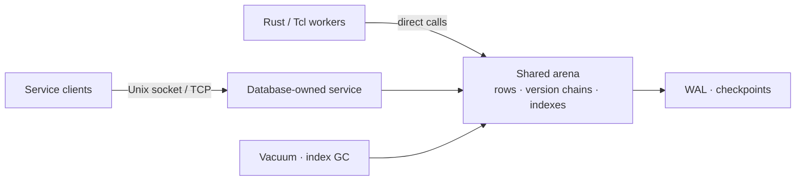

<p align="center">
  
</p>

<h1 align="center">Aerostore</h1>

<p align="center">
  <strong>A shared-memory transactional database engine in Rust.</strong><br>
  Built with AI coding agents; kept honest by proofs, oracles and benchmark sandboxes.
</p>

<p align="center">
  <a href="https://github.com/zpconn/aerostore/actions/workflows/ci.yml"></a>
  <a href="https://github.com/zpconn/aerostore/actions/workflows/verify.yml"></a>
  
  
</p>

Aerostore is a database engine for high-ingest, frequently updated state shared
by many processes on one Linux host. Worker processes map the same arena and
run **serializable transactions** directly against shared rows and transactional
secondary indexes. There is no server round trip. Write-ahead logging,
checkpoints and background reclamation sit underneath. A Tcl extension exposes
the engine to flight-tracking code.

The goal is to replace PostgreSQL's transactional state store in both
single-machine and multi-machine FlightAware HyperFeed, with at least 10× the
sustainable message throughput under matched semantics and resource budgets.
That target has not been demonstrated. The repository uses synthetic
flight-tracking scenarios informed by published HyperFeed descriptions; it does
not include HyperFeed's application code.

> **Status: experimental.** Linux only, including WSL2. APIs and storage formats
> still change. Aerostore is not yet a formally verified database, and it is not
> ready for production.

## Results at a glance

| Workload | Aerostore | PostgreSQL | Ratio | Latency and checks |
| --- | ---: | ---: | ---: | --- |
| Service workload, 24 workers, two 905 s trials per engine | **6,400** msg/s | 704 msg/s | **9.09×** | p99 9.0–9.2 ms vs 41.8–42.4 ms; full-history correctness companions pass |
| Service workload, 16 workers (earlier) | 3,072 msg/s | 640 msg/s | 4.8× | Both within the 50 ms p99 budget and every guard |
| Crucible storage churn, 2 GiB, 120 s | 315,881 ops/s | 51,098 ops/s | 6.18× | Exact table/index agreement; allocation audit passes |
| Crucible storage churn, 2 GiB, 240 s | 309,568 ops/s | 50,592 ops/s | 6.12× | Keeps 98% of the 120 s throughput |

The service rows count fully processed incoming messages while arrivals
continue. Each message is a serializable transaction that discovers its writes
through index queries; maintenance jobs run alongside. Crucible counts storage
operations. The [queue-profile report](docs/hyperfeed_queue_profile.md) and its
[comparison receipt](evidence/hyperfeed_queue_profile_2026-09-30/workers24-accepted-comparison01.json)
bind the headline result.

**What these numbers do not show:**

- **They are lower bounds.** Each service rate is the highest offered rate that
  passed repeatedly, not a measured maximum; no higher Aerostore rate was tried.
  9.09× is a ratio of tested endpoints, not of maximum capacities, and it is not
  the 10× goal.
- **PostgreSQL was not tuned for this workload.** PostgreSQL 16.13 ran with
  128 MiB `shared_buffers`, nine indexes and serialization-error SQL logging.
  Aerostore used five secondary indexes and direct row-ID access. A tuned
  baseline is planned.
- **Durability differs.** Both acknowledge commits asynchronously. Aerostore
  used a volatile memfd arena and a file WAL with `fdatasync` every 10 s.
  PostgreSQL kept `fsync` and `full_page_writes` on, with a 10 s WAL-writer
  delay. Equal crash-loss windows and recovery behavior are not established.
- **Crucible tail latency was worse.** Aerostore's update-only p99 was worse
  than PostgreSQL's. Those historical percentiles are power-of-two bucket
  bounds, so tail ratios are imprecise.
- **Scope.** Each service engine ran under the same 24-logical-CPU and 36 GiB
  memory budget, on one host. Physical multi-machine performance is unmeasured.
  The instrumented correctness companions exceed the latency budget, so capacity
  comes from the uninstrumented repeated trials.

Failed and inconclusive experiments stay in the record, including two
socket-write optimizations that were rejected for the headline run.

## How it works



- **Direct mode.** Every process maps the arena, which uses relative pointers.
  A transaction takes a snapshot from a shared `ProcArray`, reads version
  chains, buffers its writes, and validates at commit. Bound secondary indexes
  use skiplists. Each index has 4,096 predicate buckets whose stamps catch
  phantoms, including "found nothing, so create" races. Commit encodes the WAL
  record before taking locks and logs it before publishing rows and index
  entries together.
- **Database-owned service.** One owner process executes every storage
  operation for socket clients. It carries the 9.09× result. It is also the
  path to isolating worker failures: a killed client cannot strand engine
  locks. It currently lives in the benchmark harness.

**Why it is fast:**

- There is no client/server hop or SQL executor in direct mode.
- Workload-shaped access paths: a shared primary-key map, and range seeks that
  jump straight to the bound.
- Conflicts are detected by checking stamps at commit, not by holding locks
  across application logic.
- WAL encoding stays out of the critical section, and updates log only
  changed columns.
- Old versions return to shared free lists instead of growing the arena.
- A warm attach skips log replay.

The [architecture guide](docs/architecture.md) covers the full design, its
commit sequence, and where the costs remain.

## How it was built

Aerostore was built with AI coding agents. Systems code written this way is only
as trustworthy as its checks, so three kinds of guardrails grew alongside the
engine:

- **Proofs bound to production source.** Verus proves properties of actual
  engine functions. An independent Lean chain works over extracted Rust. A
  committed proof-input lock fails CI when proved code drifts.
- **Tests and oracles.** Extended Crucible replays every transaction against a
  serial reference model and PostgreSQL. Contention runs must produce a complete
  serial witness. Deterministic fault-injection probes kill processes at chosen
  cut points.
- **Benchmark sandboxes.** Preserved baseline and candidate executables run in
  alternating paired screens before any sustained trial. Every result carries a
  receipt, and failures are retained.

Together they caught real defects:

- skiplist entries silently lost under sustained churn;
- write skew through empty index searches;
- non-atomic row/index publication;
- WAL and checkpoint orderings that could lose acknowledged commits after a
  crash;
- a duplicate primary-key race;
- a public vacuum call that could prune a live reader's version.

Each one is described in **[Bugs found](docs/bugs-found.md)** with the check
that caught it and its repair. The history keeps agent authorship visible
through agent-authored commits and co-author trailers. The next step is a
protected research loop, in which an agent proposes an engine change and
independent judges return a single verdict. Today the
[iteration loop](docs/hyperfeed_iteration.md) provides its paired-screen stage.

## Correctness and verification

- **Proved components.** Verus checks production bucket kernels and the native
  commit, predicate, snapshot and indexed-read operations, conditional on
  explicit primitive contracts. Lean independently checks extracted kernels and
  history theorems. The claim ledger tracks 47 claims: 37 partial, 4 in
  progress and 6 open. It also lists 28 explicit assumptions.
- **Models and tests.** TLA+ covers 136 protocol, crash-ordering, checkpoint and
  retention cases, including deliberate counterexamples. Seven bounded Loom
  cases run against the production mutex. Deterministic native regressions
  reproduce the repaired races.
- **Boundary.** The CI pilot runs 72 component checks bound to source and
  executables. Whole-engine verification and the complete concurrent P1 slice
  are unfinished, and the `full` profile deliberately fails until they are done.

See the [verification workspace](verification/README.md) for exactly what is
proved, assumed and tested.

## Status and limits

- **Worker failure in direct mode.** A worker killed while holding a row lock,
  an index guard or a commit's predicate guards blocks survivors on that work
  until the engine is restarted from durable state. Its registration also pins
  vacuum. The service isolates client death at every tested cut point. See the
  [worker failure contract](docs/worker_failure_contract.md).
- **Durability.** The WAL has no frame checksums yet, and a torn tail is a
  recovery error. Each table binds to one WAL stream. The shared layout is
  version 5 with boot metadata version 7; older mappings need a cold rebuild
  from preserved WAL and checkpoints. See the
  [durability contract](verification/contracts/durability.md).
- **Out of scope.** SQL, replication, multi-table transactions and
  authentication.
- **Tcl bridge.** It has a fixed flight schema, 32,768 rows and one database
  per process.

## Quick start

You need Linux or WSL2, Rust **1.93.1** and Cargo. On Debian or Ubuntu:

```bash
sudo apt-get install -y build-essential pkg-config tcl tcl-dev clang libclang-dev python3
cargo build --release --workspace --locked
cargo test --workspace --release --locked -- --test-threads=1   # process tests run serially
```

**Rust.** Bind indexes before the first transaction, query through
`index_lookup`, and let commit maintain rows and indexes together:

```rust
#[derive(Clone, Copy, Serialize, Deserialize)]
struct Flight { callsign: i64, altitude: i32, active: bool }
impl WalDeltaCodec for Flight {}

let arena = Arc::new(ShmArena::new(64 << 20)?); // shared with forked workers
let mut flights = OccTable::new(Arc::clone(&arena), 1024)?;
for slot in 0..1024 { flights.seed_row(slot, Flight { callsign: 0, altitude: 0, active: false })?; }
let by_callsign = SecondaryIndex::<usize>::new_in_shared("callsign", Arc::clone(&arena));
flights.bind_index(by_callsign.clone(), |f| f.active.then_some(IndexValue::I64(f.callsign)))?;
let mut wal = OccCommitter::<8, 1024>::new_synchronous("aerostore.wal")?;

let mut tx = flights.begin_transaction()?;
let found = flights.index_lookup(&mut tx, &by_callsign, &IndexCompare::Eq(IndexValue::I64(42)))?;
if found.is_empty() {
    flights.write(&mut tx, 7, Flight { callsign: 42, altitude: 35_000, active: true })?;
}
wal.commit(&flights, &mut tx)?; // on SerializationFailure: abort, then retry the transaction
```

The [transactional-index guide](docs/transactional_indexes.md) covers retries,
savepoints and the commit protocol.

**Tcl.** After the workspace build, run this from the repository root. It uses
a fresh data directory and its own shared mapping:

```bash
export AEROSTORE_DEMO_DIR="$(mktemp -d)"
export AEROSTORE_SHM_PATH="$AEROSTORE_DEMO_DIR/shared.mmap"

tclsh <<'TCL'
load ./target/release/libaerostore_tcl.so Aerostore
package require aerostore

aerostore::init $env(AEROSTORE_DEMO_DIR)
aerostore::set_config aerostore.synchronous_commit on

FlightState ingest_tsv "UAL123\t37.618805\t-122.375416\t35000\t451\t1709000000" 1
puts [FlightState search -compare {{= flight_id UAL123}} -limit 10]
TCL
```

This prints `1`, the number of matching rows. The TSV fields are flight ID,
latitude, longitude, altitude, ground speed and update time.
`AEROSTORE_SHM_PATH` defaults to `/dev/shm/aerostore.mmap`; give each database
its own mapping. More examples are in `aerostore_tcl/test.tcl`.

## Reproducing the results

Read the [disk-space runbook](docs/disk-space.md) before large builds or
campaigns.

1. **Check the headline evidence.** This verifies the hashes and fetches the
   accepted campaign into `runs/evidence/`:
   ```bash
   python3 tools/evidence/check_catalog.py
   python3 scripts/fetch_evidence.py hyperfeed_queue_profile_2026-09-30
   ```
2. **Run a quick Crucible check.** It takes 30 seconds, runs Aerostore only,
   and needs no Docker:
   ```bash
   AEROSTORE_CRUCIBLE_AEROSTORE_ONLY=1 AEROSTORE_CRUCIBLE_SHM_MIB=128 \
   AEROSTORE_CRUCIBLE_DURATION_SECS=30 \
   cargo bench -p aerostore_core --bench hyperfeed_crucible -- --noplot
   ```
   Running `./scripts/check_crucible_2g_120_vs_240.sh` with Docker repeats the
   historical PostgreSQL comparison.
3. **Run the service workload.** `scripts/qualify_hyperfeed.py` drives Aerostore
   and a disposable PostgreSQL through the same handlers. The
   [qualification guide](docs/hyperfeed_qualification.md) gives the commands,
   resource budgets and gates.

**Workload calibration.** The calibrated workload reproduces two properties of
HyperFeed's operation:

- The [cadence and ordering profile](docs/hyperfeed_calibrated.md) adds per-flight
  foreground ordering and independent projection/housekeeping timers using the
  architect's 5–10-minute cadence.
- The [temporary signature dispatcher](docs/hyperfeed_affinity.md) reproduces the
  affinity policy confirmed for both HyperFeed deployments, including alias
  changes and expiry that can send one flight to multiple workers.

Multi-machine HyperFeed still uses one central database host. The
[resource review](docs/hyperfeed_capacity_resources.md) records the remaining
limits before testing the historical 100–300-worker deployments.

## Documentation

| Start with | For |
| --- | --- |
| [Architecture](docs/architecture.md) | Design, commit protocol, why it is fast, legacy modules |
| [Bugs found](docs/bugs-found.md) | What the guardrails caught and how each defect was fixed |
| [Documentation index](docs/README.md) | Every guide, contract and dated experiment report |
| [Glossary](docs/glossary.md) | Terms such as stamp, horizon, companion, offered rate and P1 |
| [Evidence catalog](evidence/README.md) | Archived campaigns, hashes and the [pre-rewrite archive](https://github.com/zpconn/aerostore-archive) |

## Repository layout

```text
aerostore_core/      engine: storage, transactions, indexes, WAL, recovery, queries; tests and benchmarks
aerostore_verified/  proved kernels used by the engine
aerostore_macros/    row-metadata derive macros
aerostore_tcl/       Tcl extension (FlightState ingest and search)
verification/        Verus, Lean, TLA+ and Loom campaigns; claim ledger; proof-input lock
scripts/, tools/     benchmark orchestration, verification runners, evidence and link checkers
docs/, evidence/     guides, contracts, dated reports; small evidence summaries and manifests
```

## Contributing and license

Bug reports, reproducible workloads and focused pull requests are welcome. Please
read [CONTRIBUTING.md](CONTRIBUTING.md) first. The short version: never weaken a
test or threshold to get a pass, keep correctness checks on when measuring, and
report failures alongside successes. Coding agents follow [AGENTS.md](AGENTS.md).

Aerostore is licensed under the [MIT License](LICENSE).
