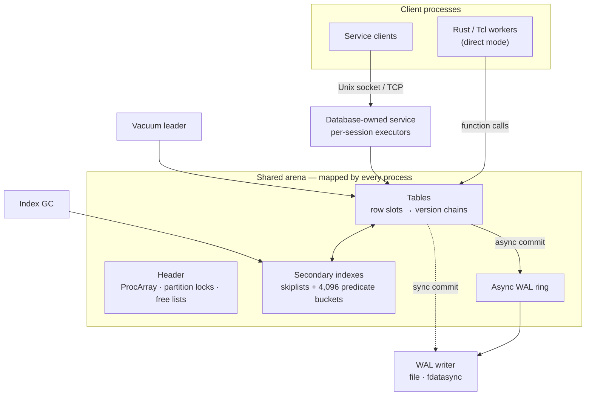

# Architecture

Aerostore is a database engine linked into its clients as a library. Several
operating-system processes map one shared arena and run serializable
transactions against it directly. Each table is bound to one write-ahead log,
and background workers reclaim old versions. An experimental database-owned
service puts the same engine behind a socket.

This page describes the current design, from storage up. It names the source
files and functions that implement each part. For guarantees and their limits,
see the [durability contract](../verification/contracts/durability.md), the
[transactional-index guide](transactional_indexes.md) and the
[worker failure contract](worker_failure_contract.md).

## Shared memory

**Mappings.** The arena is a `MAP_SHARED` region. There are three sources:

- `ShmArena::new` creates an anonymous mapping, shared with forked children.
- `map_tmpfs_shared` maps a file on tmpfs, `/dev/shm/aerostore.mmap` by
  default (`shm.rs`, `shm_tmpfs.rs`).
- The benchmark harness can back the arena with a `memfd`.

**Pointers.** Every pointer inside the arena is a `RelPtr<T>`: a 32-bit offset
from the mapping base, checked for bounds and alignment on use. The same
structure therefore works in every process, wherever the mapping lands. An
arena is at most 4 GiB.

**Header.** The header holds:

- the transaction-ID counter;
- the 256-slot `ProcArray` of active transactions;
- 1,024 partition locks for row publication;
- the free lists;
- the vacuum leader's PID;
- the boot-layout offset.

**Allocation.** Allocation bumps a shared high-water mark with CAS. It first
tries a recycled block of the same size class. There are nine classes: general
blocks, row versions, skiplist nodes, postings, towers, and four spill sizes.
Each class has one free list guarded by a process-shared mutex. `OccTable`
keeps its own 1,024-shard recycler for row versions on top of this.

**Boot.** A valid existing mapping is attached warm, skipping snapshot load and
WAL replay. Otherwise the engine boots cold and rebuilds from the checkpoint and
WAL. A warm attach clears every `ProcArray` registration, so it requires that
no other process is still running (`open_boot_context` in `bootloader.rs`). The
current shared layout is **version 5** and boot metadata is **version 7**. A
mismatched mapping is rejected rather than reinterpreted.

## Transactions

`OccTable` (`occ_partitioned.rs`) is the transactional table. The Tcl
extension and every benchmark use it. Each row has a stable slot whose head
points to a chain of versions. Each version carries `xmin`, an atomic `xmax`,
a row-lock flag and a link to the next version.

**Begin.** `begin_transaction` reserves a transaction ID and a `ProcArray`
slot under a short lifecycle lock. It captures a snapshot: the oldest active
ID, the next ID, and the set in flight. Reads follow the version chain to the
version visible to that snapshot. Writes stay private until commit, and
savepoints truncate the private write set.

**Isolation.** Isolation is serializable optimistic concurrency control.
Nothing is locked while application logic runs. At commit, the transaction
validates:

- its **read set**: no read version was replaced by a concurrent commit;
- its **write bases**;
- foreign **row locks**;
- its **predicate dependencies**.

Read-only transactions validate too. A conflict returns `SerializationFailure`.
The caller then aborts and retries the whole transaction, with jittered
exponential backoff from `RetryPolicy`.

**Phantoms.** Every bound secondary index has 4,096 hash buckets, each with a
short-lived publication lock and a stamp naming the last commit that changed
it. `index_lookup` does four things:

1. Takes the relevant bucket locks: the key's bucket for equality, the union
   for `In`, and every bucket for a range, or a contiguous run under the
   ordered policy.
2. Checks that no stamp is newer than the transaction's start.
3. Records each `(index, bucket, stamp)`, *even when nothing matches*.
4. Releases the locks before reading rows.

Commit rechecks those stamps. That is how two transactions that each "find
nothing and create" are kept from both committing.

**Hot rows.** `lock_for_update` sets an in-row lock that makes competing
transactions fail fast instead of wasting work. `lock_indexed_rows` is an
optional application-level coordination lock; the Tcl ingest path uses it.

## Commit

`OccCommitter::commit` (`wal_writer.rs`) drives `commit_with_record`
(`occ_partitioned.rs`). With a WAL bound, the order is:

1. Check that the table is bound to this WAL stream.
2. Compute each row's final write and every index-key change.
3. **Encode the WAL payload before taking any lock**, so encoding never lengthens
   the critical section.
4. Acquire index-bucket locks in canonical order, then row-partition locks.
   Each acquisition is bounded; contention returns a retryable failure.
5. Check poison, then validate predicates, reads, row locks and write bases.
6. Insert every destination posting. Source postings and row heads still hold
   the old state.
7. **Accept the WAL record.** Synchronous: append and `fdatasync` under a file
   lock. Asynchronous: push onto the shared ring. A rejection rolls back the
   inserted postings and aborts cleanly.
8. Remove source postings and publish row versions.
9. Deregister from the `ProcArray`, then stamp every changed bucket with a
   fresh ID.
10. Release the locks.

The stamp is allocated after deregistration, not taken from the writer's start
ID. A transaction that started early but committed late must still invalidate
an overlapping reader. A reader that starts after the stamp sees the whole
commit.

If anything fails after step 7, the table is **poisoned**: the commit's outcome
is indeterminate, and further transactional access fails until recovery.
Callers must not retry an indeterminate commit as if it had aborted.

## Secondary indexes

A secondary index (`shm_index.rs`, `shm_skiplist.rs`) is a skiplist in shared
memory plus its predicate-bucket header.

**Locking.** Every skiplist operation, reads included, runs under one
process-shared mutation lock. This is deliberate. An earlier lock-free design
silently lost entries under sustained churn; see [bugs found](bugs-found.md).
Published keys are immutable. A key move publishes the destination before it
removes the source.

**Range scans.** These seek directly to the lower bound with `seek_ge` and stop
at the upper bound, so a narrow range never walks the whole list.

**Binding.** `bind_index` registers an index and a deterministic key extractor.
It first checks that existing postings exactly match the rows. The registry is
sealed at the first transaction, and a bound index rejects raw mutations, so
the index can only change through commit.

**Publication policy.** `Hashed` is the default. `OrderedI64 { origin, width }`
maps time-like keys to interval buckets. A near-term range query then does not
conflict with updates scheduled far in the future.

**Index GC.** A forked index-GC process retires deleted nodes and postings
older than the oldest snapshot. Allocation pressure also triggers an inline GC
assist.

## Durability

**Format.** The WAL is a sequence of length-prefixed `rkyv` commit frames. Each
write is a full row, or a **delta**: a dirty-column mask plus only the changed
bytes. A delta is used only when its round trip verifies; otherwise the full
row is logged.

**Synchronous commit.** Each commit is appended and `fdatasync`ed before it is
acknowledged. A failed write is truncated away. If even that fails, the table
is poisoned.

**Asynchronous commit.** The record goes onto a shared-memory ring. A forked
writer daemon drains the ring in batches and calls `fdatasync` every ten
seconds and at shutdown. An asynchronous acknowledgement is **not** durable:
it is roughly PostgreSQL's `synchronous_commit = off`.

**One stream per table.** A table binds to exactly one WAL stream on its first
logged commit. Switching streams on a live table is rejected.

**Checkpoints.** A checkpoint (`write_occ_checkpoint_and_truncate_wal`) holds
every partition lock from row capture to WAL truncation. It records the ID
cutoff *and* the transactions active at capture, so replay includes a
transaction that began before the cut but committed after it. The file is
written to a temporary name, synced, renamed and its directory synced, and only
then is the WAL truncated.

**Recovery.** Recovery (`recover_occ_table_from_checkpoint_and_wal`) loads the
checkpoint, then replays the frames after the cut or in flight at it.

**Limits.** Frames carry no checksums. A torn or corrupt tail is reported as a
recovery error; recovery does not stop at the last valid frame.

## Reclamation

The vacuum daemon (`vacuum.rs`) runs as a thread in whichever process wins a
CAS on the shared leader-PID slot. If that process dies, another process takes
over. Every second, or sooner when a writer runs out of space, the daemon
computes the horizon: the oldest snapshot still pinned in the `ProcArray`. It
then unlinks unlocked versions older than that horizon and returns them to the
free lists.

Each snapshot pins the horizon it captured. A reader therefore keeps exactly the
versions it needs, and no longer than it needs them. The public
`vacuum_reclaim_once` clamps any caller-supplied horizon to the retained one.

## Queries

Queries use the Tcl STAPI form, for example
`-compare {{= flight_id UAL123} {> altitude 30000}} -sort ... -limit 10`.
Supported operators are `null`, `notnull`, `=`, `!=`, `<`, `<=`, `>`, `>=`,
`in`, `match` and `notmatch` (`stapi_parser.rs`, `filters.rs`).

A rule-based planner (`rbo_planner.rs`) picks an access path in this order:

1. equality on the primary-key map or on the bound index with the most distinct
   keys;
2. a range index;
3. a full scan.

The executor (`execution.rs`) reapplies the complete predicate to visible rows.
`StrictSnapshot` validates and retries within a finite budget.
`ChunkedEventual` is an explicitly weaker mode that scans with independent
chunk snapshots.

## The database-owned service

In direct mode a worker that dies holding a lock or mid-commit can block
survivors (see the [worker failure contract](worker_failure_contract.md)). The
database-owned service moves every storage operation into one owner process.

**Protocol.** Clients send `Begin`, `Read`, `Query`, `Write`, `Savepoint`,
`Rollback`, `Commit`, `Abort` and `Resolve` requests. Requests are
length-prefixed frames over a Unix socket or TCP. The owner gives each session
its own executor thread.

**Client death.** If a client dies, the owner aborts its open transaction, or
finishes a commit it had already accepted. A replacement client can resolve a
lost commit reply while the outcome is still retained.

**Status.** The service carries the headline 6,400 messages/s result, and it
passed selected client-kill tests at every protocol cut. It currently lives in
the benchmark harness (`aerostore_core/benches/contention_crucible/service.rs`),
not in the library. It is a research prototype, not a supported server.

## Tcl extension

`aerostore_tcl` exposes these commands:

- `aerostore::init ?dir?`
- `aerostore::set_config`
- `aerostore::get_config`
- `aerostore::checkpoint_now`
- `FlightState ingest_tsv`
- `FlightState search`

The extension has a fixed `FlightState` schema with six indexes and a
32,768-row capacity. It allows one database per process. Commits are
synchronous by default. A checkpoint runs every 300 seconds in synchronous
mode.

## Proved kernels

`aerostore_verified` holds three small functions with Verus and Lean proofs:

- two bucket canonicalizers, a sort-based one and a bitmap one;
- the stamp comparison `stamp_precedes_snapshot`.

The engine always uses the proved stamp comparison. The two canonicalizers are
opt-in features (`verified-buckets-sort`, `verified-buckets-bitmap`) until one
proves neutral or better in whole-engine measurements. The default build keeps
the standard-library sort and dedup.

## Why it is fast

The measured advantage over PostgreSQL comes from systems-level differences.
No single micro-optimization accounts for it.

1. **No server hop in direct mode.** Rows and indexes are mapped into the
   worker. A read or a commit is a function call, with no protocol framing,
   socket round trip or executor setup. Service mode gives part of this back,
   because clients pay one RPC per operation.
2. **Access paths shaped to the workload.** Keyed lookups use a shared
   primary-key map. Bound skiplist indexes seek straight to a range. The
   planner picks the most selective index.
3. **Conflict detection without a lock manager.** Predicate protection is a
   handful of bucket stamps checked at commit. Nothing is held across
   application logic, and the locks taken during lookup and commit are short
   and bounded.
4. **Less logging work in the critical section.** WAL payloads are encoded
   before any lock is taken, and updates log only changed columns. The
   asynchronous ring amortizes `fdatasync` across many commits.
5. **Recycling instead of allocation.** Old versions return to per-class free
   lists and row-version shards. Sustained update churn therefore reuses
   memory instead of growing the arena.
6. **Warm restarts.** A valid mapping reattaches in microseconds instead of
   replaying the log.

**Where it is not faster.** Some costs remain:

- Range predicates lock every bucket, unless the ordered policy applies. Broad
  queries therefore cost more and retry more.
- The skiplist mutation lock serializes index structure changes. Profiling
  attributes the service's recurring CPU bursts to predicate-lock acquisition,
  mostly on the due-time index's commit locks.
- At 6,400 messages/s the service still makes about 0.96 retries per message.
- On the original Crucible, Aerostore's update-only p99 was worse than
  PostgreSQL's.

These advantages depend on the workload and the durability configuration.
They are not a general claim that Aerostore is faster than PostgreSQL.

## Legacy modules

`aerostore_core` still contains earlier engine generations that the live path
does not use:

- `occ_legacy`;
- the heap `arena`, with `mvcc`, `txn` (apart from `TxId`) and `query`;
- `wal::DurableDatabase` and the `LogicalDatabase` with its logical WAL;
- `watch`.

Some of them are exported at the crate root under the obvious names, such as
`Table`, `Transaction` and `WalRecord`, while the live types use aliases such
as `ShmChunkedArena` and `DeltaWalRecord`. The P0 audit excludes these modules,
and the [overhaul plan](../OVERHAUL_PLAN.md) schedules their removal. New code
should use the recommended entry points:

- `ShmArena`, or `open_boot_context` for warm/cold boot;
- `OccTable`, with `SecondaryIndex::new_in_shared` and `bind_index`;
- `OccCommitter`, either `new_synchronous`, or `new_asynchronous` with
  `SharedWalRing` and `spawn_wal_writer_daemon`;
- `write_occ_checkpoint_and_truncate_wal` and
  `recover_occ_table_from_checkpoint_and_wal`;
- `spawn_vacuum_daemon`;
- `RuleBasedOptimizer` and `ExecutionEngine` for STAPI queries.
